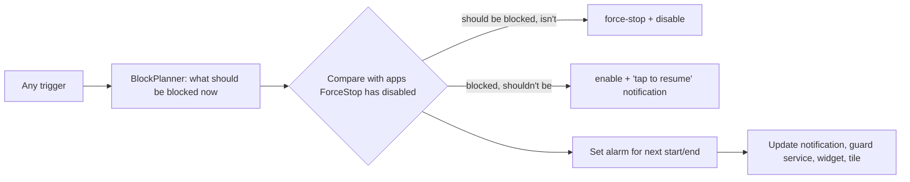

# ForceStop

ForceStop is an Android app that blocks **WhatsApp** or **WhatsApp Business** for a chosen time, so that calls don't ring and messages don't arrive. When the block ends, the app comes back exactly as it was, and everything that was sent in the meantime is delivered.

- Calls don't ring. Callers see "Calling", not "Ringing".
- Messages wait on WhatsApp's servers. Senders see a single tick until the block ends.
- Chats, media and settings are never touched.
- Ordinary SIM calls and SMS are not affected.

It works without root, using [Shizuku](https://shizuku.rikka.app/) for the system-level access Android requires.

---

## Contents

- [How it works](#how-it-works)
- [Features](#features)
- [Requirements](#requirements)
- [Setup](#setup)
- [Using ForceStop](#using-forcestop)
- [After a reboot](#after-a-reboot)
- [Architecture](#architecture)
- [Building](#building)
- [Limitations](#limitations)
- [Troubleshooting](#troubleshooting)
- [Privacy](#privacy)
- [Roadmap](#roadmap)

---

## How it works

A normal Android app is not allowed to stop or disable another app. ForceStop gets that permission through **Shizuku**, which runs a small helper process as Android's `shell` user (the same user `adb` uses). ForceStop sends its commands to that helper.

### Why ForceStop disables the app instead of just force-stopping it

The obvious approach, *force-stopping* WhatsApp, was tested first on a real phone (Moto g84 5G, Android 15) and wasn't enough:

| Approach | Result on the test phone |
|---|---|
| Force stop | Google's push service respects the stopped state, but **Meta's preinstalled service (`com.facebook.services`) woke WhatsApp again within ~20 seconds** through its own push channel (FBNS), and calls rang. |
| Force stop + suspend + cut WhatsApp's network | Meta's push carries the call itself, so WhatsApp still registered the incoming call with Android's call system and **it rang despite the suspension**. |
| **Force stop + disable** | **Nothing can start a disabled app.** No call rang and no message arrived during the block. Everything arrived after it ended. |

So a block runs:

```
am force-stop <package>
pm disable-user --user 0 <package>
```

and ending a block runs:

```
pm enable --user 0 <package>
```

If disabling ever fails, ForceStop falls back to suspending the app (`pm suspend`).

While an app is disabled, Android hides its launcher icon. That's expected, and the [widget](#home-screen-widget) can stand in for it. The icon comes back when the block ends.

---

## Features

- **Block now** for 15 min, 30 min, 1 h, 2 h, 4 h or 8 h, or until a chosen time. Debug builds also offer 1 min, for testing.
- **Weekly schedules**, for example *weekdays 10 PM – 7 AM*. Windows that cross midnight are supported, and a window belongs to the day it starts, so "Mon–Fri 22:00–07:00" blocks Monday night through Saturday morning.
- **Unblock now** and **+15 min** buttons in the app, in the notification and on the widget. Unblocking during a scheduled block only skips that one window; the schedule keeps running afterwards.
- **WhatsApp and WhatsApp Business** can be blocked at the same time, each with its own end time.
- **Instant re-block.** While a block is running, a lightweight foreground service watches for the app being re-enabled (from Settings or the Play Store) and disables it again within a second.
- **Survives reboots.** A disabled app stays disabled through a restart. Timers are re-armed on boot, app update, clock change and time zone change.
- **Quick Settings tile** ("Block app") to block or unblock with one tap.
- **Home-screen widget** showing "Blocked until 6:00 PM" with an Unblock or Block button.
- **"Tap to resume" notification** when a block ends. Tapping it opens the app so held messages and missed calls arrive straight away.
- **Setup wizard** that checks Shizuku, notifications, exact alarms, battery restrictions and whether WhatsApp is installed.
- **Shizuku start helper.** ForceStop switches on Wireless debugging by itself and opens Shizuku, so after a reboot you only tap *Start*.
- **Diagnostics screen** with the app's stopped/disabled/suspended state, a shell that runs commands through Shizuku, and a persistent event log.

---

## Requirements

| | |
|---|---|
| Android | 8.0 (API 26) or newer. Starting Shizuku without a computer needs Android 11+ (Wireless debugging). |
| Shizuku | v11 or newer. Tested with v13.6.0. |
| Developer options | Must be enabled, with **Wireless debugging** available. |
| Wi-Fi | Needed **only to start Shizuku**, because Android only allows Wireless debugging on Wi-Fi. Any Wi-Fi network works, even one without internet. Blocking itself works on mobile data. |
| Root | Not needed. |

---

## Setup

### 1. Install the apps

1. Install **Shizuku** from [shizuku.rikka.app/download](https://shizuku.rikka.app/download/) or Google Play.
2. Install **ForceStop**. See [Building](#building), or install a release APK.

### 2. Enable Developer options

**Settings → About phone →** tap **Build number** seven times. Then go to **Settings → System → Developer options** and enable **Wireless debugging**.

### 3. Pair Shizuku with Wireless debugging (one time only)

Shizuku's **Start** button only works after this step. If Start fails, or Shizuku shows its pairing screen, it hasn't been paired yet.

1. Open **Shizuku**. Under **Start via Wireless debugging**, tap **Pairing**.
2. Open **Settings → Developer options → Wireless debugging → Pair device with pairing code**. Leave the 6-digit code on screen.
3. Pull down the notification shade. In Shizuku's notification, tap **Enter pairing code** and type the code.
4. Return to Shizuku and tap **Start**.

ForceStop includes this guide too: **"Start fails in Shizuku? Pair it first"** on the home screen and in Setup.

### 4. Set up ForceStop

Open ForceStop. The setup screen walks through:

| Item | Required | Why |
|---|---|---|
| Shizuku | Yes | Running, and ForceStop allowed to use it ("Allow all the time"). |
| Notifications | Yes | The countdown while blocked, and the "tap to resume" reminder that brings the app back. |
| WhatsApp | Yes | WhatsApp or WhatsApp Business must be installed. |
| Exact alarms | Recommended | Blocks end exactly on time. |
| Unrestricted battery | Recommended | Stops battery saving from delaying timers. Matters most on Motorola, Samsung and Xiaomi. |

The first time Shizuku connects, ForceStop grants itself `WRITE_SECURE_SETTINGS` through Shizuku. That lets it switch Wireless debugging on for you after future reboots.

---

## Using ForceStop

### Block now

1. Pick the app (if both WhatsApps are installed).
2. Pick a duration, or **Until…** to choose an end time.
3. Tap **Block**.

The app disappears from the launcher, and an ongoing notification counts down. When the block ends you get **"WhatsApp block ended — tap to resume"**. Tap it, or open WhatsApp, and everything that was sent arrives.

### Schedules

**Schedules → Add schedule.** Choose the app, the start and end times, and the days the block **starts** on. Each schedule has an on/off switch. Tap a schedule to edit or delete it.

### Quick Settings tile

Pull down Quick Settings, tap the edit (pencil) button, and drag **Block app** into your tiles. One tap blocks the last app you picked for the last fixed duration you used (1 hour by default). Tap again to unblock. Unblocking from the lock screen asks you to unlock first.

### Home-screen widget

Long-press the home screen → **Widgets** → **ForceStop**. It shows the block status, with **Unblock now** or **Block 1 h**.

### Diagnostics

The wrench icon on the home screen opens Diagnostics:
- stopped / suspended / disabled state of the selected app,
- **Force stop now** and **Re-enable** buttons (an escape hatch),
- a shell that runs commands as the shell user through Shizuku,
- the event log, which survives restarts.

---

## After a reboot

Android stops Shizuku whenever the phone restarts.

- **Blocks already running stay in place.** A disabled app stays disabled through a reboot.
- **Starting and ending blocks need Shizuku.** If a block is due to start or end while Shizuku is down, ForceStop shows a notification and catches up as soon as Shizuku is back.

To restart Shizuku:

1. Connect to Wi-Fi.
2. Tap the **Start Shizuku** notification ForceStop shows after boot, or the **Start Shizuku** button in the app.
3. ForceStop turns on Wireless debugging and opens Shizuku. Tap **Start**.

---

## Architecture

Kotlin, Jetpack Compose (Material 3), Shizuku API, AlarmManager. No database: state is a small JSON document in SharedPreferences.

```
app/src/main/java/com/abhishek/forcestop/
├── ForceStopApp.kt          App start: logs, state, notification channels, reconcile on Shizuku connect
├── block/
│   ├── BlockManager.kt      Single owner of blocking; every entry point ends in sync()
│   ├── BlockPlanner.kt      Pure logic: what should be blocked now, when the next change is
│   ├── Schedule.kt          Weekly schedule and time-window math (DST-safe, overnight windows)
│   ├── BlockRepository.kt   Persisted state: manual blocks, schedules, skips, restricted packages
│   ├── BlockAlarms.kt       One exact alarm for the next start or end
│   ├── BlockGuardService.kt Foreground service during blocks; re-blocks on PACKAGE_CHANGED
│   ├── BlockActionReceiver.kt  Alarm, notification and widget actions
│   ├── SystemEventReceiver.kt  Boot, app update, clock and time zone changes
│   └── Notifications.kt     Countdown, block ended, still disabled, start Shizuku
├── engine/AppController.kt  restrict() / release() / forceStop() over Shizuku
├── shizuku/
│   ├── ShellService.kt      AIDL user service running inside Shizuku as the shell user
│   ├── ShizukuShell.kt      Binds the service on demand, unbinds after 30 s idle
│   ├── ShizukuStatus.kt     Running / permission / ready state
│   └── ShizukuStarter.kt    Turns on Wireless debugging and opens Shizuku
├── target/                  Supported apps (WhatsApp, WhatsApp Business, debug test app)
├── tile/BlockTileService.kt Quick Settings tile
├── widget/BlockWidgetProvider.kt  Home-screen widget
├── setup/SetupState.kt      Checks shown in the setup wizard
└── ui/                      Compose screens: setup, home, schedule editor, diagnostics
```

### The sync loop

Every trigger (UI, tile, widget, alarm, notification action, boot, Shizuku connecting, the app being re-enabled) goes through `BlockManager.sync()`:



Because every trigger re-checks the whole state instead of trusting events to arrive in order, missed alarms, reboots and overlapping schedules sort themselves out. ForceStop also remembers which packages it has disabled, so a release that failed (for example because Shizuku was down) is retried later.

### Battery

- No wakelocks, polling loops or repeating alarms.
- One exact alarm, set only for the next block start or end.
- The guard service exists only during a block and just waits for a system broadcast.
- The Shizuku helper process is shut down 30 seconds after the last command.
- The countdown on screen only ticks while ForceStop is visible.

---

## Building

Requirements: JDK 17 and the Android SDK (platform 35).

```bash
git clone https://github.com/abhishek-0203/ForceStop.git
cd ForceStop
./gradlew assembleDebug          # app/build/outputs/apk/debug/app-debug.apk
./gradlew testDebugUnitTest      # schedule and planner unit tests
./gradlew lintDebug
```

Android Studio creates `local.properties` (with `sdk.dir`) when it opens the project. From the command line, create it yourself:

```properties
sdk.dir=/path/to/Android/sdk
```

Install on a connected phone:

```bash
adb install -r app/build/outputs/apk/debug/app-debug.apk
```

**Debug builds** add **Google Keep** as a harmless test target, so you can try blocking without touching WhatsApp. Release builds only offer WhatsApp and WhatsApp Business.

| | Version |
|---|---|
| Android Gradle Plugin | 8.7.3 |
| Gradle | 8.12 |
| Kotlin | 2.0.21 |
| Compose BOM | 2024.12.01 |
| Shizuku API | 13.1.5 |
| minSdk / targetSdk | 26 / 35 |

---

## Limitations

- **Shizuku must be started after every reboot**, on Wi-Fi. Shizuku can only start itself on boot on rooted phones.
- **Developer options and Wireless debugging must stay enabled.** Turning them off may stop Shizuku on some phones. Some banking or UPI apps refuse to run while debugging is on.
- **The app's icon is hidden during a block**, because disabled apps aren't shown in the launcher. On some launchers, a home-screen shortcut may not come back after re-enabling; the app is still in the app drawer.
- **Re-enabling from Settings or the Play Store ends a block early**, until the guard service disables the app again (within a second while a block is running).
- **Personal use.** ForceStop uses `USE_EXACT_ALARM`, `REQUEST_IGNORE_BATTERY_OPTIMIZATIONS`, a `specialUse` foreground service and a self-granted `WRITE_SECURE_SETTINGS`, which Google Play restricts. It's meant to be sideloaded, not published on Google Play.
- Only WhatsApp and WhatsApp Business are supported so far.

---

## Troubleshooting

| Problem | Fix |
|---|---|
| **Start fails in Shizuku** / Shizuku shows its pairing screen | Shizuku hasn't been paired with Wireless debugging. Follow [step 3 of Setup](#3-pair-shizuku-with-wireless-debugging-one-time-only). |
| **"Connect to Wi-Fi first"** | Wireless debugging only works on Wi-Fi. Any Wi-Fi network works, even without internet. |
| **"Shizuku isn't connected"** banner | Tap **Start Shizuku**, then **Start** in Shizuku. |
| **WhatsApp still disabled after a block ended** | Shizuku was down when the block ended. Start Shizuku and ForceStop re-enables it automatically. Or go to **Settings → Apps → WhatsApp → Enable**. |
| **WhatsApp icon missing after unblocking** | Find it in the app drawer and drag it back to the home screen. |
| **A block didn't end on time** | Allow **Exact alarms** and **Unrestricted battery** in Setup. |
| **What happened?** | **Diagnostics → Event log** records every block, unblock, re-block and Shizuku event, with timestamps. |

---

## Privacy

ForceStop has **no internet permission** and collects nothing. All state (blocks, schedules, the event log) stays on the phone in the app's private storage.

---

## Roadmap

- App picker to block any app, not just WhatsApp.
- Profiles (e.g. "Work focus": a group of apps plus a schedule).
- Block history and statistics.
- Root support as an alternative to Shizuku.
